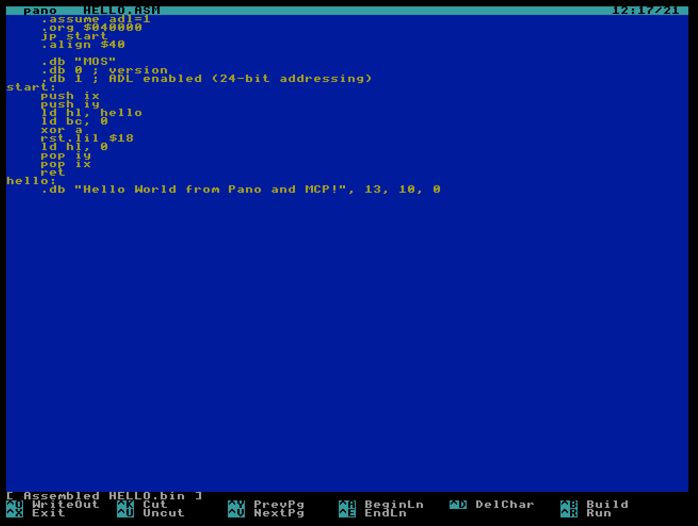

# microedit80 (`pano` & `mcp`)

A minimal, nano-inspired full-screen text editor (`pano`) for Agon and CP/M-80, paired with an Agon `$B0000` MOSlet launcher (`mcp`) that turns `pano` into an edit-assemble-run loop around `ez80asm`. Written in the Turbo Pascal 3.0 dialect for [PASTA/80](https://github.com/pleumann/pasta80).

[](https://youtu.be/-r6V85u82s0)

## Building

Requires PASTA/80 (with `sjasmplus`):

```bash
# Agon (editor + MOSlet launcher)
pasta80 --agon pano.pas
pasta80 --agon --moslet mcp.pas

# CP/M-80
pasta80 --cpm pano.pas
```

## Running

### Agon (with `mcp` IDE loop)
Copy the binaries onto your Agon SD card:
- `mcp.bin` -> `/mos/mcp.bin`
- `pano.bin` -> `/bin/pano.bin`
- `ez80asm.bin` -> `/bin/ez80asm.bin`

Then start from MOS:

```text
mcp [filename]
```

You can also load and run `pano.bin` standalone at `$40000` for editing without `mcp`.

### CP/M-80
Run in full-screen VT52 mode (`-s` in `tnylpo`):

```bash
tnylpo -s pano.com [filename]
```

## How the Agon Build/Run Loop Works

On Agon, normal user binaries (`pano.bin`, `ez80asm.bin`, and assembled programs) load at `$40000`, so launching another `$40000` binary directly from `pano` would overwrite `pano` in memory.

To keep `pano` in full 64 KB `$40000` space (rather than squeezing it into a 32 KB MOSlet), `mcp` runs in `$B0000` MOSlet space and coordinates `pano` and `ez80asm` via `PANO.TMP`:

1. `mcp` loads and runs `/bin/pano.bin` at `$40000` with the target filename.
2. Pressing `^B` (Build) or `^R` (Run) in `pano` saves the file, writes `PANO.TMP`, and exits to `mcp`.
3. `mcp` reads `PANO.TMP`, clears the screen, deletes any previous output `.bin` and `PANO.ERR`, and runs `ez80asm <src> <out> -c`.
4. If assembly fails, `err_asm.inc` uses `scrchar.asm` (`VDU 23, 0, &83`) to scan `ez80asm` output bottom-up from the VDP screen buffer and writes the error in PASTA/80 format (`*** Error at <file>(<line>,<col>): <message>` or `*** Error: <message>`) to `PANO.ERR`, while setting status `ERR` in `PANO.TMP`.
5. If assembly succeeds and `^R` was pressed, `mcp` loads and runs the assembled `.bin` at `$40000` and waits for a keypress before returning.
6. Otherwise `mcp` re-launches `pano` immediately. `pano` reads `PANO.TMP` and deletes it: if `PANO.TMP` status is `ERR`, `pano` reads `PANO.ERR` to jump to the error location and show the message (leaving `PANO.ERR` on disk, ignored unless `PANO.TMP` status is `ERR`); otherwise it restores the saved cursor position.
7. Exiting `pano` normally (`^X`) deletes `PANO.TMP` so `mcp` returns cleanly to MOS.

### `PANO.TMP` & `PANO.ERR` Format

`PANO.TMP` has 5 fixed lines:
1. Action / status (`C`, `R`, `OK`, `ERR`)
2. Source filename
3. Output `.bin` filename
4. Saved cursor row
5. Saved cursor column

`PANO.ERR` (checked only when `PANO.TMP` status is `ERR`) uses PASTA/80's standard error format:
- `*** Error at <file>(<line>,<col>): <message>`
- `*** Error: <message>` (locationless fallback; non-matching context lines are skipped)

## Features

- Adapts dynamically to `ScreenWidth` and `ScreenHeight` (80x60 on Agon mode 0, 80x24 on CP/M) with inverse header bar (`line:col/lines`), scrolling viewport, status/prompt row, and 2-row shortcut bar
- Half-page vertical jumping scroll (`ViewRows div 2`) and chunked horizontal scroll (20 columns)
- Packed heap line storage (`Lines` pointer array + `CurLine` active-line buffer, `nil` for blank lines, `DefragMem` on low heap)
- Text insertion, tab expansion (4-column tab stops), line split (`Enter`), backspace/join, `^D` delete/join, and `^K`/`^U` line cut/uncut
- Startup file loading (`ParamStr(1)`), `^O` WriteOut, and `^X` save-modified prompt
- Platform-specific error codes and key decoding isolated behind a single include switch (`plat_agon.inc` / `plat_cpm.inc`)

## Keybindings

| Key | Action |
| --- | --- |
| Arrow keys | Move cursor (VT52/CSI on CP/M; FabGL `sysvar_vkeycode` on Agon) |
| `Home` / `End`, `^A` / `^E` | Beginning / end of line |
| `PgUp` / `PgDn`, `^Y` / `^V` | Previous / next page |
| `Tab` | Insert spaces to next 4-column stop |
| `Enter` | Split line |
| `Backspace` / `^D` | Delete before / at cursor |
| `^K` / `^U` | Cut / uncut line |
| `^O` | WriteOut file |
| `^B` | Build with `ez80asm` (Agon via `mcp`) |
| `^R` | Build and run with `ez80asm` (Agon via `mcp`) |
| `^X` | Exit (prompts to save if modified) |

## Files

- `pano.pas` — Main program, globals, platform include switch, and event loop
- `mcp.pas` — Agon `$B0000` MOSlet launcher coordinating `pano`, `ez80asm`, and program execution
- `err_asm.inc` — `ez80asm` VDP screen scanner and standardized error formatter for `mcp`
- `scrchar.asm` — Agon VDP `VDU 23, 0, &83` screen-character reader helper for `mcp`
- `buffer.inc` — Active-line buffer and packed heap line management
- `ui.inc` — Screen rendering, viewport scrolling, and shared key decoding
- `plat_agon.inc` — Agon MOS error codes and key decoding
- `agonkey.asm` — Agon `sysvar_vkeycode`/`sysvar_keyascii` reader (separates arrow/navigation keys from colliding ASCII Ctrl bytes)
- `plat_cpm.inc` — CP/M-80 error codes and VT52/CSI key decoding
- `fileio.inc` — File loading, WriteOut, IDE state handoff, and exit-save prompts
- `LICENSE` — GNU General Public License v3.0

## License

Copyright (c) 2026 Stefan Haustein.

Licensed under the [GNU General Public License v3.0](LICENSE) (GPL-3.0).
